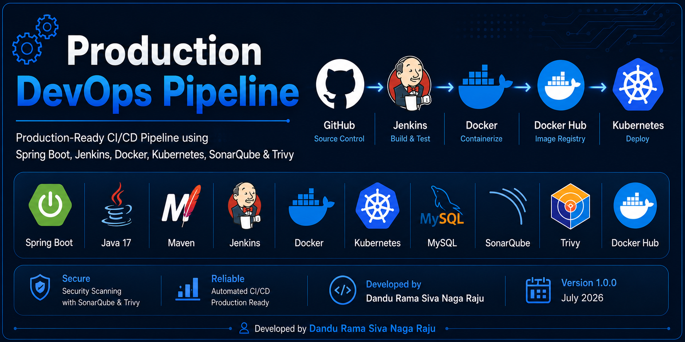

<p align="center">
  
</p>

<h1 align="center">Production DevOps Pipeline</h1>

<p align="center">
  <strong>A Production-Ready CI/CD Pipeline built using Spring Boot, Jenkins, Docker, Kubernetes, SonarQube, Trivy, and MySQL.</strong>
</p>

<p align="center">


</p>

---

# Project Overview

Modern software delivery requires more than writing application code—it demands automation, security, quality assurance, and reliable deployments.

This project demonstrates a **production-style DevOps CI/CD pipeline** for a Spring Boot application. It automates the complete software delivery lifecycle, including code compilation, testing, static code analysis, security scanning, containerization, image publishing, and Kubernetes deployment.

The pipeline integrates industry-standard DevOps tools to ensure every change is validated, securely packaged, and deployed consistently.

## Key Highlights

- Automated CI/CD pipeline using Jenkins
- Spring Boot REST API with MySQL
- Maven build, test, and package automation
- Code quality analysis using SonarQube
- Filesystem and container image security scanning using Trivy
- Docker image creation and publishing to Docker Hub
- Kubernetes deployment with rolling updates
- Health verification using Spring Boot Actuator
- Infrastructure organized using Docker Compose and Kubernetes manifests
- Production-oriented repository structure and automation scripts

---

# Features

## CI/CD Automation

- Automated CI/CD pipeline using Jenkins
- Source code checkout from GitHub
- Maven build lifecycle automation
- Automated unit testing with JUnit 5
- Code coverage generation using JaCoCo
- Automatic artifact packaging
- Docker image build and push to Docker Hub
- Automated Kubernetes deployment
- Deployment verification and health checks

---

## Code Quality & Security

- SonarQube static code analysis
- Trivy filesystem vulnerability scanning
- Trivy Docker image security scanning
- Secure Docker image creation
- Spring Boot Actuator health monitoring

---

## Containerization

- Production-ready Dockerfile
- Multi-container setup using Docker Compose
- Docker Hub image publishing
- Container health checks

---

## Kubernetes Deployment

- Deployment with rolling updates
- Service exposure using NodePort
- ConfigMaps for application configuration
- Kubernetes Secrets for sensitive data
- Persistent Volume Claims (PVC)
- MySQL deployment inside Kubernetes
- Readiness and Liveness Probes
- Resource Requests & Limits

---

## Spring Boot Application

- RESTful Employee Management API
- CRUD Operations
- DTO Pattern
- Validation
- Exception Handling
- Spring Data JPA
- MySQL Database
- Swagger/OpenAPI Documentation
- Spring Boot Actuator

---

# Architecture

The following diagram illustrates the end-to-end CI/CD workflow implemented in this project.

<p align="center">
    
</p>

---

# CI/CD Pipeline Workflow

The Jenkins pipeline automates the complete software delivery lifecycle, from source code checkout to Kubernetes deployment. Every stage has a specific responsibility to ensure the application is built, tested, secured, containerized, and deployed consistently.

The workflow follows two major phases:

- **Continuous Integration (CI)** – Build, test, validate code quality, and create a deployable artifact.
- **Continuous Delivery (CD)** – Package the application as a Docker image, publish it to Docker Hub, deploy it to Kubernetes, and verify a successful rollout.

---

## Continuous Integration (CI)

The Continuous Integration phase validates every code change before deployment. It ensures that the application compiles successfully, passes all automated tests, meets quality standards, and is free from known security vulnerabilities.

### Stage 1 – Checkout Source Code

**Purpose**

Retrieve the latest source code from the GitHub repository.

**Why it is required**

Every pipeline execution must work on the latest version of the application to ensure builds are reproducible.

**Outcome**

- Downloads the latest code
- Initializes the Jenkins workspace

---

### Stage 2 – Maven Verify

**Purpose**

Compile the application and execute the Maven verification lifecycle.

**Why it is required**

This stage ensures the application builds successfully and all project dependencies are resolved.

**Outcome**

- Source code compilation
- Dependency validation
- Maven lifecycle verification

---

### Stage 3 – JUnit Test Execution

**Purpose**

Execute automated unit tests.

**Why it is required**

Automated testing detects regressions early and validates business logic before deployment.

**Outcome**

- Executes JUnit 5 test cases
- Generates test reports
- Prevents deployment if tests fail

---

### Stage 4 – JaCoCo Code Coverage

**Purpose**

Measure automated test coverage.

**Why it is required**

Code coverage helps evaluate how much of the application is validated through automated testing.

**Outcome**

- Generates HTML coverage report
- Highlights untested code
- Supports quality improvement

---

### Stage 5 – SonarQube Code Analysis

**Purpose**

Perform static code analysis.

**Why it is required**

Detects bugs, vulnerabilities, security hotspots, and code smells before deployment.

**Outcome**

- Code quality analysis
- Maintainability metrics
- Security analysis
- Technical debt reporting

---

### Stage 6 – Trivy Filesystem Scan

**Purpose**

Scan the project filesystem for vulnerabilities and security issues.

**Why it is required**

Security scanning before containerization reduces the risk of packaging vulnerable dependencies.

**Outcome**

- Dependency vulnerability scanning
- Secret detection
- Misconfiguration detection

---

## Continuous Delivery (CD)

After the application successfully completes all validation and security checks, the pipeline proceeds with packaging and deployment.

### Stage 7 – Docker Image Build

**Purpose**

Build a production-ready Docker image.

**Why it is required**

Containers ensure consistent application behavior across development, testing, and production environments.

**Outcome**

- Creates Docker image
- Packages the Spring Boot application
- Produces a deployable container

---

### Stage 8 – Docker Push

**Purpose**

Push the Docker image to Docker Hub.

**Why it is required**

Docker Hub acts as the centralized image registry from which Kubernetes pulls application images.

**Outcome**

- Authenticates with Docker Hub
- Pushes the latest application image
- Makes the image available for deployment

---

### Stage 9 – Kubernetes Deployment

**Purpose**

Deploy the latest application version to the Kubernetes cluster.

**Why it is required**

Kubernetes manages application lifecycle, scaling, and availability.

**Outcome**

- Applies Kubernetes manifests
- Updates Deployment
- Creates or updates Pods
- Maintains desired state

---

### Stage 10 – Rollout Verification

**Purpose**

Verify that Kubernetes successfully completed the deployment.

**Why it is required**

Ensures the application starts correctly before marking the deployment successful.

**Outcome**

- Waits for rollout completion
- Detects deployment failures
- Validates Pod readiness

---

### Stage 11 – Health Check

**Purpose**

Verify application availability after deployment.

**Why it is required**

A successful deployment should also produce a healthy, responsive application.

**Outcome**

- Executes Spring Boot Actuator health endpoint
- Confirms application readiness
- Marks the pipeline successful

---

## Continuous Delivery (CD)

After the application successfully completes all validation and security checks, the pipeline proceeds with packaging and deployment.

### Stage 7 – Docker Image Build

**Purpose**

Build a production-ready Docker image.

**Why it is required**

Containers ensure consistent application behavior across development, testing, and production environments.

**Outcome**

- Creates Docker image
- Packages the Spring Boot application
- Produces a deployable container

---

### Stage 8 – Docker Push

**Purpose**

Push the Docker image to Docker Hub.

**Why it is required**

Docker Hub acts as the centralized image registry from which Kubernetes pulls application images.

**Outcome**

- Authenticates with Docker Hub
- Pushes the latest application image
- Makes the image available for deployment

---

### Stage 9 – Kubernetes Deployment

**Purpose**

Deploy the latest application version to the Kubernetes cluster.

**Why it is required**

Kubernetes manages application lifecycle, scaling, and availability.

**Outcome**

- Applies Kubernetes manifests
- Updates Deployment
- Creates or updates Pods
- Maintains desired state

---

### Stage 10 – Rollout Verification

**Purpose**

Verify that Kubernetes successfully completed the deployment.

**Why it is required**

Ensures the application starts correctly before marking the deployment successful.

**Outcome**

- Waits for rollout completion
- Detects deployment failures
- Validates Pod readiness

---

### Stage 11 – Health Check

**Purpose**

Verify application availability after deployment.

**Why it is required**

A successful deployment should also produce a healthy, responsive application.

**Outcome**

- Executes Spring Boot Actuator health endpoint
- Confirms application readiness
- Marks the pipeline successful

---

## Pipeline Summary

The complete CI/CD pipeline performs the following automated workflow:

```text
Developer
     │
     ▼
GitHub Repository
     │
     ▼
Jenkins Pipeline
     │
     ├── Checkout
     ├── Maven Verify
     ├── JUnit Tests
     ├── JaCoCo
     ├── SonarQube
     ├── Trivy Filesystem Scan
     ├── Docker Build
     ├── Docker Push
     ├── Kubernetes Deployment
     ├── Rollout Verification
     └── Health Check
     │
     ▼
Production-Ready Kubernetes Deployment
```

This automated workflow ensures that every code change is validated, securely packaged, and consistently deployed with minimal manual intervention.

---

# 🛠️ Technology Stack

| Category | Technologies |
|-----------|-------------|
| Language | Java 17 |
| Framework | Spring Boot 3 |
| Build Tool | Maven |
| Database | MySQL 8 |
| ORM | Spring Data JPA |
| Testing | JUnit 5, Mockito |
| API Documentation | Swagger / OpenAPI |
| Containerization | Docker |
| Container Orchestration | Docker Compose |
| CI/CD | Jenkins |
| Code Quality | SonarQube |
| Security | Trivy |
| Monitoring | Spring Boot Actuator |
| Version Control | Git & GitHub |

---


# 📂 Project Structure

```text
production-devops-pipeline/
│
├── app/
│   └── springboot-app/
│       ├── src/
│       ├── target/
│       └── pom.xml
│
├── docker/
│   └── Dockerfile
│
├── docker-compose/
│   ├── docker-compose.yml
│   └── .env
│
├── scripts/
│   ├── docker-build.sh
│   ├── docker-compose-deploy.sh
│   ├── docker-cleanup.sh
│   ├── health-check.sh
│   ├── trivy-fs-scan.sh
│   └── trivy-image-scan.sh
│
├── reports/
├── docs/screenshots/
├── Jenkinsfile
├── README.md
└── .gitignore
```

---

# 🚀 REST API Endpoints

| Method | Endpoint | Description |
|----------|----------|-------------|
| GET | `/api/employees` | Get all employees |
| GET | `/api/employees/{id}` | Get employee by ID |
| POST | `/api/employees` | Create employee |
| PUT | `/api/employees/{id}` | Update employee |
| DELETE | `/api/employees/{id}` | Delete employee |

---

# ❤️ Health Endpoint

```
GET /actuator/health
```

Response

```json
{
  "status": "UP"
}
```

---

# 📊 CI/CD Pipeline

The Jenkins pipeline performs the following stages automatically:

- Checkout Source Code
- Maven Compile
- Unit Testing
- Publish Test Reports
- JaCoCo Code Coverage
- SonarQube Analysis
- Trivy Filesystem Scan
- Package Application
- Docker Image Build
- Docker Image Verification
- Trivy Image Scan
- Docker Compose Deployment
- Health Check Verification

---

# 🐳 Docker

Build image

```bash
docker build -t production-devops-pipeline:latest -f docker/Dockerfile .
```

Run container

```bash
docker run -d \
-p 8082:8082 \
production-devops-pipeline:latest
```

---

# 🐳 Docker Compose

Start the application

```bash
docker compose --env-file docker-compose/.env \
-f docker-compose/docker-compose.yml up -d
```

Stop services

```bash
docker compose --env-file docker-compose/.env \
-f docker-compose/docker-compose.yml down
```

View running services

```bash
docker compose --env-file docker-compose/.env \
-f docker-compose/docker-compose.yml ps
```

---

# 🧪 Running Tests

```bash
cd app/springboot-app

mvn test
```

---

# 📈 JaCoCo Coverage

Generate report

```bash
mvn test
```

Coverage Report Location

```
target/site/jacoco/index.html
```

---

# 🔍 SonarQube Analysis

Run SonarQube analysis

```bash
mvn sonar:sonar
```

The Jenkins pipeline automatically performs SonarQube analysis and publishes quality metrics.

---

# 🔒 Security Scanning

Filesystem Scan

```bash
./scripts/trivy-fs-scan.sh
```

Docker Image Scan

```bash
./scripts/trivy-image-scan.sh
```

---

# 📷 Project Screenshots

## GitHub Repository


---

## Project Structure


---

## Swagger UI


---

## Get Employees API


---

## Create Employee API


---

## JUnit Test Results


---

## JaCoCo Code Coverage


---

## SonarQube Dashboard


---

## SonarQube Project Overview


---

## Trivy Filesystem Scan


---

## Docker Images


---

## Running Docker Containers


---

## Jenkins CI/CD Pipeline


---

## Health Check Verification


---

## Spring Boot Actuator


---

## Docker Compose Services


---

# ▶️ Local Setup

Clone repository

```bash
git clone https://github.com/Nagaraju-209/production-devops-pipeline.git

cd production-devops-pipeline
```

Build application

```bash
cd app/springboot-app

mvn clean package
```

Start using Docker Compose

```bash
docker compose \
--env-file docker-compose/.env \
-f docker-compose/docker-compose.yml up -d
```

Application

```
http://localhost:8082
```

Swagger UI

```
http://localhost:8082/swagger-ui/index.html
```

Health Endpoint

```
http://localhost:8082/actuator/health
```

---

# 📌 Future Enhancements

- Kubernetes Deployment
- Helm Charts
- Prometheus Monitoring
- Grafana Dashboards
- Terraform Infrastructure
- GitHub Actions Pipeline
- AWS Deployment
- NGINX Reverse Proxy

---

# 👨‍💻 Author

**Dandu Rama Siva Naga Raju**

- GitHub: https://github.com/Nagaraju-209
- LinkedIn: https://www.linkedin.com/in/dandu-rama-siva-naga-raju/

---

# ⭐ Support

If you found this project useful, consider giving it a ⭐ on GitHub.

It helps others discover the project and motivates continued improvements.

---

# 📄 License

This project is licensed under the MIT License.